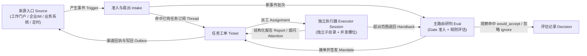

# AI 员工与助理平台需求与深化设计文档（AIWorker PRD）

更新日期：2026-11-18

本文在 [PROJECT_GOALS.md](PROJECT_GOALS.md) 与 [dsh_platfrom_prd.md](dsh_platfrom_prd.md) 已确认产品框架的基础上，结合本地参考源码 `related projects/deepseek-harness`（简称 `dsh`）与 `related projects/dsh-superagent-prototype`（简称 `superagent`）的架构与交互机制，整理平台各模块的深化产品设计，作为后续原型迭代与工程实现的依据。原型的逐项验证明细见 [VERIFICATION_LOG.md](VERIFICATION_LOG.md)。

> **状态标注约定**：文中将已确认的产品规则直接写入正文；基于 `dsh` 与 `superagent` 源码机制提炼的深化交互与字段设计标为**候选设计**；需结合试点客户与实施环境决定的事项标为**待确认**。

---

## 一、产品总体架构与底层机制映射

### 1.1 产品定位与双轨场景

平台面向企业组织及组织内个人，部署于客户私有云、企业内网或边缘环境，围绕两类核心场景提供服务：

1. **提升个人工作效率：助理 + 工作台（1 通用 + N 业务）**
   - **1 通用**：提供通用办公助理、个人/共享工作空间、个人自动化任务与个人资源积累，处理日常文档、数据分析、纪要整理等办公事务。
   - **N 业务**：针对工程造价、ET 设计、招投标、外贸、项目管理、界面设计等专业场景提供定制化业务工作台，采用「业务操作区 + 智能对话/操作区」双区协同，围绕当前业务对象（图纸、台账、招标机会、装箱方案等）使用配套组织助理或个人助理。
2. **提升组织协作效率：组织 AI 员工**
   - 组织 AI 员工归组织所有，拥有独立工作空间与组织授予的知识、技能、MCP、浏览器控制及业务系统连接权限。
   - 支持**人员主动交办**（通过工作门户、企业消息渠道或已授权业务系统）与**后台自动触发**（按定时规则或业务事件触发），在职责范围内自主完成短流程，或作为业务流程节点与真人、其他 AI 员工及业务系统交接。

### 1.2 产品模块与参考源码机制映射

| 平台产品模块 | 对应底层参考机制（`dsh` / `superagent`） | 核心复用与适配关系 |
| --- | --- | --- |
| **通用会话与右侧工具区** | `dsh`：`core/session`、`core/agent-loop`、`ui-conversation`、`ui-chat`、`ui-tool`、`ui-deliverables`、`ui-sidebar-right`、`ui-dockkit` | 复用 Turn/Step 事件流、过程分组折叠、工具调用树卡片、回合末尾产物与文件变更卡片（`present` + `workspace/changes`）、右侧可分栏工具面板（文件树/预览/Diff/网页/终端）。 |
| **人机协同交互** | `dsh`：`interaction/user-approval`、`user-questions`、`permission-presets`、`plan-mode` 及对应 `ui-*` 包 | 复用会话内工具审批卡（单次允许/始终允许/拒绝）、结构化澄清问答卡（`ask_user_question`）、权限挡位切换（`/permission`）与规划模式审阅卡（`/plan`）。 |
| **我的助理与组织助理** | `dsh`：`preset/agent-preset`、`agent-preset-registry`、`preset/persona`、`ui-agent-preset` | 专职助理映射为带作用域隔离的 `agent-preset`；角色设定映射为 `dsh-persona`（`prefix` / `suffix` / `complete`）；平台扩展组织分配、成员共享及工作台配对逻辑。 |
| **资源库与凭据管理** | `dsh`：`skill/*`、`mcp/*`、`llm/*`、`credentials/*`、`boot/plugin-manager`、`ui-settings-models`、`ui-plugin-manager` | 按模型、技能、MCP、知识、插件、工具分类建模；凭据通过 `CredentialRef` 与配置分离存储；平台扩展「个人 / 成员共享 / 组织共享」三级范围与授权校验。 |
| **个人自动化任务** | `dsh`：`schedule/schedule`、`schedule/tool-schedule`、`ui-schedule` | 复用 7 类时间规则（含 Cron/RRULE）、3 类投递目标模式（复用新会话 / 每次新建会话 / 关联已有会话）、工作空间绑定与投递回执记录。 |
| **组织 AI 员工** | `superagent`：`Engine`（`Intake` / `Evals` / `Tickets` / `Assignments` / `Replies`）、`Policy`、`DshExecutor`、`Prompts`、`HealthBoard` | 复用主路由 Session + 独立工单执行器 Session 双层架构、准入表与三级接收模式（`off / observe / auto`）、`Mandate` 授权凭证、7 阶段工单状态机、结构化提示词与监管面板；平台扩展多员工实例、组织角色权限与通用业务工具。 |
| **业务工作台** | `dsh`：Client Slots（`ui-slots`）、动态客户端模块（`client/modules`）、Host/Client Controller | 业务工作台作为平台模块或插件承载业务对象视图，通过共享上下文与助理会话及 AI 员工任务引擎联动。 |
| **权限与访问控制** | `dsh`：`api/remote-access` + 平台自建组织权限层 | 在 `remote-access` 资源动作校验基础上，扩展企业组织架构、三类管理角色、AI 员工三类职责角色及业务对象读写权限。 |

### 1.3 门户与管理后台整体导航

- **工作门户**（面向全体组织成员，按权限开放入口）：
  - **工作区**：新建会话、我的助理（个人配置 / 他人共享 / 组织助理配置入口）、工作空间（个人空间 / 共享空间）、个人自动化任务、已获授权的业务工作台。
  - **AI 员工**：员工目录（沟通与交办）、任务总览（全部任务 / 我交办的任务 / 待我处理）、我的员工分身（按维护授权开放：员工管理 / 运行监管 / 评估记录）。
  - **资源库**：按类型（全部 / 模型 / 技能 / MCP / 知识 / 插件 / 工具）与范围（全部 / 我的 / 共享）浏览、维护个人资源及进入组织资源维护。
- **管理后台**（面向组织管理员及获委派的部门管理员，支持与工作门户一键切换并各自恢复离开前页面）：
  - **概览**：平台概览，向组织管理员展示组织使用和运行情况。组织管理员首次进入后台默认打开此页，后续切回恢复上次页面。
  - **组织管理**：组织与成员（部门目录、成员与调岗交接）、角色与权限。
  - **能力与资源**：工作台与助理（含配对分配）、AI 员工、组织资源。
  - **系统与运行**：系统接入（渠道与业务系统连接）、运行监管（全组织范围）、变更记录。

---

## 二、组织 AI 员工全链路设计（模块 C）

本节在已确认的组织 AI 员工规则（使用者 / 责任人 / 管理者三类角色、多入口交办、定时与事件触发、任务总览与运行监管）基础上，结合 `dsh-superagent-prototype` 的领域模型（[001-domain.md](related%20projects/dsh-superagent-prototype/docs/001-domain.md) ~ [005-panel.md](related%20projects/dsh-superagent-prototype/docs/005-panel.md)）进行深化设计。

### 2.1 核心领域模型与双层运行架构（候选设计）

每个启用的组织 AI 员工在运行时采用**「主路由会话 + 独立工单执行器」**双层结构，保证受理研判不被长耗时任务阻塞，且不同任务之间工作目录与上下文严格隔离：

| 领域概念 | 产品界面名称 | 定义与核心业务规则 |
| --- | --- | --- |
| **Source（来源）** | 接入入口 / 触发源 | 产生触发事件的渠道或系统实例，包括：工作门户沟通、企业消息渠道（如飞书/企微机器人）、业务系统事件源（如项目系统、招投标数据源）及平台定时调度器。每个来源维护自身的读取游标与连接健康状态，重启不重复回放历史事件。 |
| **Trigger（触发）** | 触发事件 | 来源产生的一条不可变事件记录，包含来源标识、触发人（`actor`）、是否人工发起（`human`）、是否明确指向员工（`mention` @提及 / `direct` 私聊交办）、原始正文及业务元数据。同一触发事件多次受理只生成一个任务。 |
| **Thread（线程）** | 沟通线程 / 业务上下文 | 同一会话或同一业务对象关联的有序触发事件流。每个线程同一时刻最多运行一次研判（Eval），期间新到达的事件合并入下一批次。一个线程可关联多个独立任务。 |
| **Policy（策略）** | 岗位策略快照 | 由「主动工作规则列表 + 主动接收模式（`off / observe / auto`）+ 各来源准入表与白名单」共同构成的不可变版本（`policyVersion`）。策略变更会终止正在运行的 Eval 并重新排队，同时向受影响的在途任务发送策略变更通知（`policy-changed`），但不直接强杀在途执行。 |
| **Eval（研判）** | 准入与规则评估 | 分两层：**第一层 Gate（确定性准入）**校验发起人权限与触发强度（`explicit` 明确请求 / `inferred` 推断候选 / 不准入）；**第二层 Assessment（模型规则研判）**逐条核对已启用的主动工作规则，输出 `accept`（接单）、`ignore`（忽略，含观察模式下的 `would_accept`）、`stop`（停止）或 `unavailable`（评估超时/失败）。 |
| **Mandate（授权凭证）** | 任务授权凭证 | 任务被受理时生成的不可变凭证，记录：策略版本号（`policyVersion`）、核准的任务边界（`scope`）、触发强度（`explicit / inferred`）、命中的规则列表、发起人及来源范围。执行器只能在 `Mandate` 边界内行动；任务结束后被人工消息唤醒恢复前，必须基于当前生效策略重新校验（`revalidate`）该凭证。 |
| **Ticket（工单）** | AI 员工任务 | 一项获授权工作的完整管理单元。持有其 `Mandate`、关联线程订阅（`Subscriptions`）、输入队列（`Inputs`）、历次派工记录（`Assignments`）与结果回执。任务拥有独立于底层会话的状态机。 |
| **Assignment（派工）** | 执行轮次 | 任务与一次具体执行器实例的绑定。一个任务在生命周期内可有多次派工（首轮执行、补充信息后继续、异常恢复后重试）。每次派工绑定员工的独立执行器会话（`worker-<taskId>`）与独立工作目录，通过结构化 `Report` 向任务汇报状态。 |
| **Subscription（订阅）** | 线程跟踪 | 任务与沟通线程的多对多绑定。命中已订阅线程的人工后续消息通过**扇出（Fan-out）**直接送达该任务的执行器（无需重新走 Eval 立项）；仅用于参考上下文的关联线程（`followForContext`）只传递信息，不赋予新权限且不唤醒已结束任务。 |
| **Outbox Receipt（回执）** | 交付与写回回执 | 员工向原沟通渠道发送确认、提问、结果或向业务系统写回结论的持久化发送队列与状态记录（排队中 / 已送达 / 失败退避重试 / 渠道失效丢弃）。 |

### 2.2 角色分工与员工生命周期

1. **三类角色职责**：
   - **使用者**：在员工目录或已接入的企业消息渠道、业务系统中与获授权的 AI 员工沟通、交办任务、回答员工提问（补充信息）并查看本人有权访问的任务结果。
   - **责任人**（可由多人共同担任，细分「配置与培训」和「发布版本」两项独立权限）：
     - **配置负责人**：维护岗位结构化配置、主动工作规则、准入设置、关联资源，开展样本试用、规则试跑与观察模式核验，在运行监管中跟进异常、复核结果或接手处理。
     - **版本发布人**：将经过验证的草稿配置发布为不可变的稳定版本。
   - **管理者**（组织管理员 / 获委派的部门管理员）：在管理后台决定员工的启停状态、切换正式生效版本、分配使用者与责任人权限、管理组织级系统连接并查看运行监管元数据。
2. **四个生命周期状态**：
   - `草稿（draft）`：新建后尚未发布任何稳定版本，仅责任人和管理员可在「我的员工分身」配置与试用，不对普通成员开放。
   - `待启用（ready）`：已发布至少一个稳定版本，但管理员尚未在后台启用，员工目录不可见，后台规则不触发。
   - `已启用（enabled）`：管理员已指定生效版本并启用。获授权成员可在员工目录或外部渠道交办，已启用的定时与事件规则按生效版本运行。责任人继续修改配置或发布新版本时，不影响当前正在运行的生效版本，直至管理员在后台切换版本。
   - `已停用（paused）`：管理员停用员工，保留历史分配记录与历史任务，停止受理新交办与规则触发。

### 2.3 结构化岗位配置、试用与版本管理（候选深化设计）

在「AI 员工 → 我的员工分身 → 员工管理 → 员工详情」中，将原有的粗粒度表单深化为 4 个标签页：**岗位配置**、**准入与工作规则**、**试用与培训**、**版本管理**。

#### （1）岗位配置（结构化指令与执行环境）
参考 `superagent` 的 `Prompts`（[004-prompts.md](related%20projects/dsh-superagent-prototype/docs/004-prompts.md)）与 `ExecutorConfig`，将单一「工作方法」拆分为职责边界清晰的结构化配置块：

| 配置分组 | 字段名称 | 说明与界面呈现 |
| --- | --- | --- |
| **基本信息** | 名称、岗位名称（Role）、职责概述、头像配色 | 用于员工目录卡片展示与身份标识。 |
| **任务边界与工作方法（Ticket Scope）** | 职责内工作步骤、草稿停止条件、超范围退回规则 | 定义员工收到任务后如何开展工作、何时必须停在草稿等待确认、哪些请求属于超出单次任务边界需退回重新拆单。 |
| **沟通与打扰规范（Communication）** | 受理确认话术、主动发消息条件、单条回复字数上限（默认 100 字）、消息前缀标识 | 贯彻「最少占用人的注意力」原则：默认仅在**需人决策/补充信息、结果就绪待复核、执行受阻无法继续**三种情况下主动发消息；支持配置自动回复前缀（如「由 AI 员工自动生成，请核对」）。 |
| **交付与验收要求（Delivery Requirements）** | 交付物格式、必须附带的核对依据、自动写回条件与人工复核边界 | 定义交付时必须列出的证据项（如图纸版本号、实体坐标、原文段落引用），以及哪些结论可直接写回、哪些必须经业务负责人复核确认后才能写回。 |
| **授权资源与工具** | 组织知识库、岗位技能（Skills）、MCP 服务、工具与关联连接 | 复用现有资源选择与失效检测机制；绑定资源连接异常或被撤权时，显示黄色告警并推荐同类型可用资源替换。 |
| **执行环境与并发控制（Execution）** | 执行模型与思考强度、最大并发任务槽位（`maxWorkers`，默认 3，另保留 1 个人工跟进优先槽）、工作空间准备命令、禁用命令/操作黑名单 | 控制该 AI 员工同时处理的任务上限（确保人工追问不会被批量自动任务堵死）及安全边界。 |

#### （2）准入与工作规则（Admission & Proactive Rules）
参考 `superagent` 的 `Policy` 与 `EvalConfig`（[002-authorization.md](related%20projects/dsh-superagent-prototype/docs/002-authorization.md)）：

1. **主动工作接收模式（Accept Mode）**：
   - `关闭主动接单（off）`：仅受理获授权成员的明确交办（门户交办或渠道直接 @提及），不运行任何主动事件或群聊推断规则。
   - `观察模式（observe，新员工/新规则默认推荐）`：对业务事件、定时规则或群聊未@消息正常执行规则评估，命中时记录为**「观察命中 · 本会接单（Would accept）」**并生成拟建任务方案，但**不实际启动执行器、不打扰业务人员**，供负责人在上线前核验规则准确率。
   - `自动接单（auto）`：事件命中已启用的工作规则且目标明确时，自动创建正式任务并派工执行。
2. **渠道准入策略表（Source Admission）**：
   - 展示各接入入口（工作门户、企业消息群聊、企业消息私聊、业务系统事件）对不同发送方的准入策略：
     - **已授权成员明确交办 / @提及**：固定为 `明确请求（explicit）`，在所有接收模式下均可直接受理。
     - **已授权成员在监测群内未 @提及的消息**：可选 `规则研判（inferred）` 或 `忽略（ignore）`。
     - **未单独授权成员在公共支持群 @提及**：可选 `明确请求（explicit）`、`规则研判（inferred）` 或 `忽略（ignore）`。
     - **白名单业务系统 / 机器人事件**：仅作为 `规则研判（inferred）` 候选，不可直接发起无规则任务或停止人工任务。
3. **主动工作规则列表（Rules）**：
   - 每条规则包含：规则 ID 与名称、启用开关、触发类型（文件更新 / 定时计划 / 外部系统事件 / 流程节点交接）、匹配条件（关键词或表达式）、**工作内容指令**、**预期交付物与去向**、**人工接手条件**、**指定业务负责人（Owner）**。
   - 规则变更会自动更新策略版本号（`policyVersion`）。

#### （3）试用与培训（Trial & Training）
- **双模式试用**：
  - **交办样本试用**：内置「正常完结样本」「缺少依据转人工样本」「超范围退回样本」，对比「预期结果」与「模拟执行结果 + 命中的配置段落依据」，支持录入**纠正反馈**并一键合入岗位配置（如追加到「任务边界」或「交付要求」）。
  - **事件规则试跑**：输入模拟事件类型与内容，展示完整的**两层评估过程**——准入判定结果、逐条已启用规则的匹配结论与理由（`rule_assessments`）、在当前接收模式（`observe` / `auto`）下的最终决定（生成模拟运行记录或观察记录）。

#### （4）版本管理与组装预览（Versions & Prompt Preview）
- **完整策略组装预览（Full Prompt & Policy Preview）**：可展开查看当前配置组装出的完整系统指令与策略快照（按「角色与公共规范 → 任务边界 → 沟通规范 → 交付要求 → 授权资源与环境 → 主动工作规则列表」顺序组装），并高亮显示与当前生效版本的差异（Diff）。
- **版本修订历史**：每次保存或发布记录版本号、修订时间、操作人、策略版本哈希（`policyVersion`）及变更摘要；支持从历史版本恢复为当前草稿。

---

### 2.4 员工沟通、交办与线程跟进交互（模块 C2，候选深化设计）

在「AI 员工 → 员工目录 → 员工沟通页（[EmployeesView.vue](frontend/src/views/EmployeesView.vue)）」中深化以下交互：

1. **沟通发起与交办提案**：
   - 成员既可点击「交办任务」（或从「常见任务」模板选择）直接填写任务标题、具体要求、期望交付物及关联业务对象（如 ET-052 图纸版本），也可先在沟通框用自然语言讨论。
   - 沟通中形成明确工作意图时，AI 员工在回复下附带**「建议交办卡片」**（预填拟定标题、任务范围 Scope 与交付物），用户可确认或微调后正式提交。
2. **任务受理确认卡（Mandate Confirmation）**：
   - 任务创建后，沟通时间线立即插入结构化的**任务受理卡**，展示：
     - 任务编号与标题、当前阶段标签；
     - **核准范围（Mandate Scope）**与预期交付物；
     - 触发方式（如「门户明确交办 · 策略版本 `v2`」）；
     - 快捷操作：`查看进度/结果`、`补充信息`（待回答时）、`停止任务`。
3. **同一线程内的后续消息路由（Subscription Fan-out vs Handback）**：
   - 当用户在已有进行中任务的沟通线程里发送后续消息时，提供清晰的路由反馈：
     - **范围内补充（In-scope Follow-up）**：消息直接扇出送达该任务的执行器（标记为 `已送达任务 #ID`，不产生新任务），执行器读取后更新当前任务进度。
     - **超出原任务范围退回（Handback）**：若用户发送的要求超出当前任务 `Mandate` 边界（例如在「核对南区图纸接线」任务线程中要求「顺便重算北区土建工程量」），执行器将该消息**附理由退回主路由**，界面在消息旁展示**「超出当前任务范围」提示卡**，说明退回原因，并提供**「拆分为新任务交办」**按钮一键预填新交办单。
4. **结构化待人工回答卡（Attention / `human_action`）**：
   - 当执行器在运行中发现缺失关键资料或需发起人拍板时，通过结构化 `Attention` 提问，沟通流和任务卡片高亮显示**「待我回答」问题卡**（列出具体问题、缺失项说明、直接回复输入框及「按现有资料继续」次要按钮），用户回答后立即解除阻塞并恢复同一执行轮次。

---

### 2.5 任务阶段状态机与全链路详情（模块 C3，候选深化设计）

#### （1）统一的互斥任务阶段（对齐 `superagent` `ticketStage`）
将普通交办任务与场景/自主任务统一对齐到清晰、互斥、面向行动者的阶段分类（优先级从高到低，第一条命中即生效）：

| 阶段分组 | 阶段标识 | 界面状态文案 | 判定条件与需要谁行动 |
| --- | --- | --- | --- |
| **需人工处理（Person）** | `person / delivery` | **输入投递异常**（红/橙） | 补充信息或事件送达执行器失败；系统自动指数退避重试，负责人或发起人也可手动点击「重试投递」。 |
| **需人工处理（Person）** | `person / answer` | **待我补充 / 待回答**（橙） | 执行器发起了结构化提问（`Attention`），等待发起人或业务负责人回答问题或补充资料。 |
| **需人工处理（Person）** | `person / review` | **待复核**（橙） | 执行器最新报告为 `ready`（已产出核对结论或候选方案），等待当前接手的业务负责人复核确认、退回补充或做出立项决策。 |
| **需人工处理（Person）** | `person / blocked` · `failed` | **执行受阻 / 执行失败**（红） | 执行器最新报告为 `blocked`（如依赖系统未连接、权限不足）或 `failed`，且此后尚无新的人工消息介入；等待管理员恢复连接或接手人点击「重试任务」。 |
| **执行与排队（Working）** | `working / queued` | **排队等待槽位**（蓝/灰） | 任务已受理，正在等待该员工空闲的并发执行槽位（`maxWorkers`）或正在初始化工作目录。 |
| **执行与排队（Working）** | `working` | **执行中**（蓝） | 执行器正在运行当前回合，或有后台工具/子任务正在执行（最长 30 分钟保护）。 |
| **等待后续触发（Idle）** | `idle` | **等待后续事件**（灰） | 执行器已完成当前轮次并报告 `waiting`（例如长周期跟进任务等待下一阶段外部事件或评审回复）。 |
| **已结束（Ended）** | `ended / completed` | **已完成**（绿） | 交付物已生成，或经业务负责人复核确认后已写回目标业务记录。 |
| **已结束（Ended）** | `ended / dropped` | **无需处理**（灰） | 执行器核查后确认无异常、无需人工处理或已被新版本替代（`dropped`），安静结束并留存核查依据。 |
| **已结束（Ended）** | `ended / stopped` | **已人工停止**（灰） | 发起人或负责人在任务完成前主动停止任务，撤回 `Mandate` 授权。 |

#### （2）任务详情页四段式全链路溯源（[EmployeeTasksView.vue](frontend/src/views/EmployeeTasksView.vue) & [ScenarioTaskView.vue](frontend/src/views/ScenarioTaskView.vue)）
在任务详情页中，除了顶部的「当前处理操作区」和「核对结果与依据」外，提供清晰的四段式全链路记录（对普通成员展示其权限内的业务进展，对责任人和管理者展示完整执行与回执元数据）：

1. **第一段：触发来源（Trigger）**
   - 展示发起方式（人员交办 / 业务事件 / 定时规则）、来源入口（工作门户 / 企业消息 / 项目系统 / 招投标系统）、发起人或事件源、触发时间、原始请求或事件快照、关联业务对象与版本。
2. **第二段：准入与授权凭证（Eval & Mandate）**
   - 展示准入强度（`明确交办 explicit` / `规则推断 inferred`）、命中的主动工作规则名称与匹配依据、生效的员工版本与策略版本号（`policyVersion`）、核准的任务边界（`Mandate Scope`）。
   - 若任务执行期间岗位策略发生过变更，展示收到的**策略变更通知（Policy Change Notice）**记录。
3. **第三段：派工与执行轮次（Assignments & Reports）**
   - 按时间顺序列出历次派工（`Assignment #1`、`Assignment #2`…）：
     - 展示每轮派工的执行器标识（`worker-<taskId>`）、独立工作空间目录、使用的生效版本、调用的依赖连接、起止时间与耗时；
     - 展示该轮次接收的输入（`Inputs`：初始触发、人工补充信息、退回重提说明）及其读取状态（`已读 / 待读取`）；
     - 展示该轮次产出的结构化报告（`progress / waiting / ready / blocked / failed / dropped`）摘要与依据。
4. **第四段：业务复核与交付回执（Reviews & Outbox Receipts）**
   - 多人顺序复核进度条（如招投标样板：宋予安技术核实 → 周可欣商务核实 → 林知远立项决策），记录每一步的结论（确认 / 退回补充 / 不予立项）、意见与时间。
   - **渠道与写回回执（Receipts）**：展示向原沟通线程发送的通知以及向业务系统写回结论的回执状态（`已送达` / `等待连接恢复` / `发送失败已重试 N 次` / `目标会话失效已丢弃`）。

#### （3）人工停止与异常重试规则
- **停止任务（Stop Ticket）**：任务处于未结束状态时，发起人或该员工责任人可点击「停止任务」并选填原因；停止后立即撤回 `Mandate` 授权，终止在途派工，后续同一线程的消息不再自动唤醒该任务。
- **重试任务（Retry Ticket）**：当任务处于 `person / blocked`、`person / failed` 或 `person / delivery` 时，接手人或责任人可点击「重试任务」（可附补充说明），结束当前停滞的 `Assignment` 并在同一工作目录和任务编号下启动新一次 `Assignment`，自动继承此前未消费的输入。

---

### 2.6 运行监管与评估观察台（模块 C4，候选深化设计）

在「AI 员工 → 我的员工分身 → 运行监管（[EmployeeResponsibilityRuns.vue](frontend/src/components/EmployeeResponsibilityRuns.vue)）」及管理后台「系统与运行 → 运行监管（[AdminScenarioRunsView.vue](frontend/src/views/AdminScenarioRunsView.vue)）」中，对齐 `superagent` 监管面板（[005-panel.md](related%20projects/dsh-superagent-prototype/docs/005-panel.md)）的三问原则：

1. **顶部监管概览栏（回答前两问：现在有什么需要我处理？系统是否健康？）**：
   - **待人工处理统计卡**（点击直接筛选列表）：`待复核`、`待回答/待补充`、`执行受阻/失败`、`投递/写回异常`。
   - **运行负载与健康状态条（HealthBoard）**：
     - 并发执行槽位占用：`当前运行槽位 X / 最大槽位 Y`（及排队中任务数）；
     - 依赖连接状态：列出负责员工所依赖的业务系统连接与消息渠道连接状态（正常 / 待检测或中断，管理员可一键跳转恢复连接）；
     - **暂停受理与派工开关（Pause processing）**：负责人可对所负责的 AI 员工开启「暂停新任务派工」——开启后事件来源继续记录触发事件，已在执行的回合不中断，但暂停新的规则研判、任务派工和外发回执；关闭暂停后自动按序恢复处理。
2. **双视图切换：「任务运行记录」与「规则评估记录（Eval Decisions）」**：
   - **任务运行记录**：保留并增强现有「待跟进 / 全部运行」筛选，列表明确展示每条任务**当前在等谁、下一步是什么**（如「等待管理员恢复项目系统连接」「等待林知远复核图纸差异」「连接已恢复，等待接手人重试」），点击抽屉查看四段式执行与写回记录。
   - **规则评估记录（新增子视图）**：
     - 专门展示触发事件经过 `Eval` 后的研判决定，支持按结论筛选：
       - `已接单（Accept）`：显示命中的规则、生成的任务编号并可跳转任务详情；
       - `观察命中 · 本会接单（Would accept）`：展示员工在**观察模式（`observe`）**下命中的触发事件、匹配的规则理由及拟创建的任务标题与范围，提供**「转为正式任务」**和**「调整规则」**快捷入口，打通从「观察试跑」到「正式切为 `auto` 自动接单」的验证闭环；
       - `已忽略（Ignore）`：显示被准入表过滤或未命中任何启用规则的原因码（如 `未命中启用规则`、`非白名单成员未@提及`、`卡片快速忽略 ignoredFromCard`）；
       - `评估异常（Unavailable）`：显示因模型超时或策略变更中断的评估，支持点击「重新评估」或「忽略告警」。

---

## 三、个人会话与右侧工具区深化设计（模块 A，候选设计）

本节结合 `deepseek-harness` 的 `ui-conversation`、`ui-chat`、`ui-tool`、`ui-deliverables`、`interaction/*` 及 `ui-sidebar-right` 深化个人工作区的通用会话体验。

### 3.1 会话消息流与执行过程分组（Process Grouping）

1. **回合（Turn）与步骤（Step）结构化呈现**：
   - 助理处理一次用户输入不再只显示一段静态文本，而是分为**「执行过程分组（Process Group）」**与**「正式回复 + 回合尾卡（Turn Tail）」**。
   - **执行过程分组**（可折叠，运行中显示流式高亮状态）：
     - **思考过程（Reasoning）**：展示助理的推理摘要，支持展开查看完整思考文本。
     - **工具调用卡片树（Tool Call Tree）**：按调用类型展示专用卡片——文件读取/检索（`read` / `grep`，点击路径在右侧栏打开对应文件与行号）、文件写入/修改（`write` / `edit`，显示变更字节数与 `+added / -removed` 行数）、命令执行（`bash`，显示终端命令、工作目录与退出码胶囊）、技能加载（`skill`，展开查看加载的 `SKILL.md` 指令）、MCP 工具调用、子代理委派（`subagent`）。
   - **工作详情展示模式切换**：支持在会话头部或设置中切换 `简洁（Compact，完成后自动折叠过程行）` / `标准（Standard）` / `详细（Verbose，始终展开所有过程与工具卡片）`，并在回合底部可选展示本轮耗时、步骤数与 Token/缓存命中统计。

### 3.2 人机协同交互卡片（Approvals、Questions 与 Plan Mode）

当助理在执行过程中需要用户授权或补充信息时，在输入框上方（Composer Seat）挂起结构化交互卡，并在左侧会话列表对应行显示黄色待处理圆点（`等待审批` / `等待回答` / `方案待审阅`）：

1. **敏感操作权限审批卡（`user-approval`）**：
   - 当助理尝试执行工作区外写入、外部网络请求或敏感命令时弹出。
   - 展示待审批的工具名称、目标路径/命令详情与风险说明，提供 **`拒绝（Esc）`**、**`允许一次（Enter）`**、**`本会话始终允许`** 三个按钮。
2. **结构化澄清提问卡（`ask_user_question`）**：
   - 当助理需要用户明确偏好或补充关键信息（例如创建自动化任务缺少时间、整理报告需选择受众格式）时，支持展示多步单选/多选/自定义输入问答卡（首项可标为「推荐」默认选中，支持跳过或「稍后决定」暂停倒计时）。
   - 提交回答后，回答内容以右侧用户气泡形式固化在消息流中，卡片转为只读的「已回答」状态。
3. **规划模式与方案审阅卡（`plan-mode` / `/plan`）**：
   - 用户可通过输入框 `/` 菜单或芯片开启**「规划模式（Plan）」**（输入框蓝色 `Plan` 芯片可随时点击退出）。
   - 助理在规划模式下只做调研与方案设计，完成后生成结构化方案卡片并自动在右侧栏打开完整 Markdown 方案预览，输入框上方呈现**「方案审阅卡（Plan review）」**，提供 **`查看完整方案`**、**`提出修改意见`** 与 **`批准并开始执行（Approve）`**。

### 3.3 输入框增强与快捷触发（Composer & Triggers）

1. **底部控制栏（Composer Controls）**：
   - **助理选择**：发送首条消息前可切换平台默认助理、个人专职助理、组织分配助理或成员共享助理；已有会话固定显示当前助理名称与来源标签。
   - **模型与思考强度选择（Model & Reasoning Effort）**：按模型提供方分组选择当前会话使用的模型（仅展示当前用户有权使用的个人或组织模型），若模型支持思考强度则可选择 `关闭 / 低 / 中 / 高`。
   - **会话权限挡位选择（Permission Presets）**：提供 `仅可查看（Read Only）`、`工作区内修改（Workspace Write，默认）`、`完全权限（Full Access，需二次确认风险）` 三挡切换。
   - **引用文件与上下文**：支持从个人工作空间、获授权的共享工作空间或业务工作台记录中添加引用芯片。
2. **行内快捷触发（`/` 与 `@`）**：
   - 输入 `/` 弹出斜杠菜单：可快速调用已获授权的**技能（`/skill-name`）**或会话命令（`/plan` 规划模式、`/compact` 压缩上下文、`/model` 切换模型、`/permission` 切换权限、`/export` 导出会话记录）。已发送消息中的 `/skill-name` 高亮显示，点击可在右侧栏预览该技能的 `SKILL.md`。
   - 输入 `@` 弹出引用菜单：快速检索并插入工作空间文件或业务工作台记录。

### 3.4 回合产物与文件变更审阅（Turn Tail Deliverables）

结合 `dsh` 的 `ui-deliverables` 机制，每个完成的回合末尾在回复正文下方呈现两类结构化卡片：

1. **显式交付产物卡（Explicit Deliveries / `present`）**：
   - 展示助理本轮正式交付的文档、表格或报告卡片（含文件类型图标、文件名、摘要说明），支持**「在右侧栏预览」**、**「编辑并保存到个人/共享工作空间指定目录」**及**「下载到本地」**。
   - 回复正文中的行内代码文件名（如 `` `11月项目例会纪要.md` ``）自动解析为可点击链接，点击直接在右侧栏打开预览。
2. **本轮文件变更汇总卡（Changed Files / `workspace/changes`）**：
   - 当助理在工作空间内新建或修改了多个文件时，显示汇总卡片（列出改动文件数、总新增 `+N` 与删除 `-M` 行数，悬停单行可弹出快速单栏 Diff 预览）。
   - 点击任意文件行，在右侧工具栏打开**「变更审阅（Changes Review）」Tab**，支持双栏并排（Side-by-Side）或单栏统一（Unified）Diff 对比、自动换行切换及按文件下拉切换。

### 3.5 会话右侧工具区（Right Sidebar Dock）

参考 `ui-sidebar-right` 与 `ui-dockkit`，将会话右侧栏升级为按会话独立保存布局的**可分栏工具面板**：

- **面板形态**：支持 `常规停靠栏`（与对话区并排，支持水平拆分为左右 2 个子窗格对比查看）与 `全屏展开`（窄屏自动全屏），关闭最后一个非指南 Tab 时自动收起右侧栏，折叠状态下不占对话区宽度。
- **内置 Tab 类型**：
  1. **工具指南（Guide）**：空面板默认入口，展示文件目录、网页预览、终端、变更审阅、当前会话定时任务等快捷入口卡片。
  2. **工作空间文件树（Files）**：浏览当前个人空间或关联共享空间的目录树，支持一键引用到输入框或点击预览。
  3. **文档与产物预览（Document Preview）**：支持 Markdown、代码（带行号与高亮，支持按 `#L10` 定位行）、表格/CSV、HTML、图纸与文档预览，并提供「编辑并保存」操作。
  4. **变更对比（Changes Review）**：双栏/单栏对比助理对工作空间文件或产物的前后修改。
  5. **网页预览（Browser）**：在沙箱面板内预览助理生成的 HTML 原型或会话中点击的链接。
  6. **持久化终端（Terminal）**：展示命令执行环境与输出流。
  7. **关联自动化任务（Schedule Task）**：当当前会话绑有个人自动化任务时，会话头部显示时钟图标，点击在右侧栏打开该任务的规则与投递记录。

---

## 四、我的助理与资源库差异化建模（模块 B，候选设计）

### 4.1 专职助理配置模型（对齐 `agent-preset` + `dsh-persona`）

在「工作区 → 我的助理（[AssistantsView.vue](frontend/src/views/AssistantsView.vue)）」与「组织助理配置（[AdminAssistantsView.vue](frontend/src/views/AdminAssistantsView.vue)）」中，将助理配置深化为完整的 Preset 组装模型：

| 配置维度 | 字段与控件设计 | 对应 `dsh` 机制与业务校验 |
| --- | --- | --- |
| **身份与基础信息** | 名称、图标/分类标签、职责简介 | 对应 `dsh-agent-preset` 的 `id`、`name`、`description`、`order`。 |
| **角色指令（Persona）** | **角色前缀（Prefix）**：定义助理的专业身份、语气与核心原则； **工作方法与输出规范（Suffix）**：定义执行步骤、输出模板与需向用户确认的边界； **高级选项**：是否仅使用自定义前缀替换平台默认提示词（`complete`）、是否注入工作空间运行时上下文（`includeRuntimeContext`）。 | 对应 `@deepseek-ai/dsh-persona` 配置项，支持 `{{model}}` 等模板变量。 |
| **默认模型与权限挡位** | 默认模型路由（可选「跟随个人默认」或指定某个可用模型 + 思考强度）、默认会话权限挡位（`仅可查看 / 工作区内修改`） | 新建会话选用该助理时自动带入，会话中仍可按需临时切换。 |
| **内置工具能力开关** | 勾选该助理启用的平台基础能力：`工作空间文件读写`、`命令与沙箱执行`、`规划模式（/plan）`、`澄清提问（ask_user_question）`、`子代理委派（subagent）`、`个人定时任务创建`、`联网检索` | 对应 Preset 内部挂载的 `tool-fs`、`tool-bash`、`plan-mode`、`tool-ask-user`、`tool-subagent`、`tool-schedule`、`tool-web` 子插件。 |
| **绑定资源与失效替补** | 按类型分组绑定获授权的**技能（Skills）**、**MCP 服务**、**知识库**与**业务工具**；当已绑定资源因撤权、停用或连接中断不可用时，高亮展示失效原因并提供一键替换为同类可用资源或移除引用。 | 运行时按当前使用者身份二次校验资源与连接可用性。 |
| **配置清单预览（YAML）** | 提供「查看配置声明」抽屉/弹窗，以只读 YAML 格式展示该助理组装的完整 Preset 结构（类似 `ui-agent-preset` 的 `View configuration`）。 | 便于高阶用户或交付工程师核查助理配置。 |
| **共享与工作台配对** | 个人助理可选择共享给本组织指定成员（只共享配置使用权，会话、文件、产物与个人凭据各自隔离）；组织助理支持在管理后台与业务工作台设置一对一配对并按成员/部门分配。 | 收回共享或分配权限后，接收者仍可查看历史会话，但不可继续用该助理发送新消息。 |

### 4.2 资源库按类型差异化建模（[ResourcesView.vue](frontend/src/views/ResourcesView.vue)）

改变当前所有资源共用同一简陋表单的做法，针对 6 类资源分别设计专属的卡片摘要、详情视图与新增/编辑表单，同时统一保留「来源与归属」「我的权限」「当前状态与失效原因」「配置引用反查（列出引用了该资源的助理和 AI 员工）」公共区域：

| 资源类型 | 专属元数据与配置字段（候选设计） | 详情与交互特性 |
| --- | --- | --- |
| **1. 模型（Model）** | **提供方名称与 ID**（如 DeepSeek Official、内网 vLLM/Ollama 网关、第三方兼容路由）、**接口协议**（`OpenAI Chat Completions` / `OpenAI Responses` / `Anthropic Messages`）、**接口地址（Base URL）**、**凭据引用（API Key）**、**模型目录列表**（每项含模型 ID、显示名称、上下文窗口如 `128K`、最大输出如 `32K`、输入模态 `文本 / 图片`、支持的思考强度 `off/low/medium/high`） | 对齐 `ui-settings-models`：支持在一个提供方下维护多个模型并拖拽排序；支持「探测可用模型」勾选导入；API Key 采用掩码只写输入，配置只存凭据引用名（如 `DEEPSEEK_INTERNAL_KEY`）并显示绿点（已配置）/ 红点（缺失）状态。 |
| **2. 技能（Skill）** | **技能标识（`/slug`，用于会话 `/name` 调用）**、**触发方式**（`模型按需自动加载 + 用户 / 命令调用` vs `仅限用户手动 / 命令调用 disable-model-invocation`）、**适用场景说明（Frontmatter Description）**、**指令正文（`SKILL.md` Markdown）**、**附带参考资料/脚本列表（`references/`、`scripts/`）** | 对齐 `skill-filesystem` 与 `ui-skill`：详情页可直接预览格式化的 `SKILL.md` 指令内容与附属参考文件，并提供「在新建会话中试用 `/slug`」快捷按钮。 |
| **3. MCP** | **传输协议**（`Stdio 本地进程` / `Streamable HTTP` / `SSE 远程服务`）、**连接地址或启动命令**（URL 或 `command + args`）、**绑定的组织连接或凭据引用**、**超时时间**、**暴露的工具列表（Tools）与资源列表（Resources）**、**服务端说明（Server Instructions）** | 对齐 `mcp-client` 与 `mcp-resources`：详情页展示该 MCP 服务探测到的工具清单（工具名 + 参数摘要）与可读取资源（如企查查 MCP、工程规范检索 MCP），支持「测试连接」并展示连通状态。 |
| **4. 知识（Knowledge）** | **知识库类型**（文档集合 / 结构化台账 / 行业规范库）、**数据来源**（上传文档 / 关联共享工作空间目录 / 外部知识库连接）、**文档数与最近索引更新时间**、**检索范围与引用要求**（如回答时是否强制附带原文段落引用） | 详情页展示包含的文档条目摘要（如「11月项目例会纪要」「电气制图与BOM核对规范」），支持查看引用权限。 |
| **5. 插件（Plugin / Bundle）** | **Bundle 包名与版本**（如 `@dsh-plugin/demian-trade-suite`）、**安装来源**（平台内置 / 内部制品库 / 本地目录）、**包含的组件行（Plugin Rows）及各自启停开关與运行相位**（`active 已就绪` / `disabled 已停用` / `failed 启动异常`）、**插件说明文档（README 预览）** | 对齐 `ui-plugin-manager`：展示 Bundle 详情文档、内部包含的宿主/客户端插件行开关及配置入口。 |
| **6. 工具（Tool）** | **工具标识（Wire Name）**、**调用方式**（内置能力 / HTTP Webhook / 脚本工具）、**参数 Schema 摘要**、**默认安全级别**（只读免审批 / 修改工作区 / 敏感操作需人工审批）、**关联系统连接** | 详情页展示工具参数结构与调用示例。 |

### 4.3 凭据与配置分离规则（对齐 `dsh-credentials`）

- **配置不存明文密钥**：无论个人添加的模型/MCP，还是组织管理员在后台配置的模型网关与业务系统连接，配置记录中只保存**凭据引用标识（`CredentialRef`）**，密钥值单独加密存储。
- **掩码只写与状态指示**：密钥输入框默认留空并使用密码掩码（提供眼睛图标临时查看当前正在输入的内容），已保存的密钥永不回显到前端输入框；界面通过绿点（`已配置凭据`）、黄点（`使用环境变量回退`）、红点（`凭据缺失，调用将失败`）反馈状态。
- **执行身份凭据隔离**：个人助理调用个人资源时使用当前成员的个人凭据；调用组织授权资源时按组织策略使用组织共享凭据或成员本人绑定凭据；组织 AI 员工在后台或受交办运行时，固定使用授予该 AI 员工组织执行身份的凭据，不混用个人凭据。

---

## 五、个人自动化任务深化设计（模块 D，候选设计）

结合 `dsh` 的 `packages/schedule` 与 `ui-schedule`（[ui-schedule/README.md](related%20projects/deepseek-harness/packages/client/ui-schedule/README.md)），对「工作区 → 自动化任务（[PersonalAutomationsView.vue](frontend/src/views/PersonalAutomationsView.vue)）」做以下深化：

### 5.1 时间与周期规则扩展

1. **周期类型**：在现有「仅一次（`once`）」「每天（`daily`）」「每周（`weekly`）」基础上，扩展支持 **按小时/分钟间隔（`every`）**、**每月（`monthly`）** 与 **自定义规则（`custom`，支持输入标准 5 段式 Cron 表达式或 RFC 5545 RRULE）**。
2. **时区与下次运行时间**：
   - 显示任务生效时区（默认当前浏览器时区，如 `Asia/Shanghai`）；
   - 自动计算并展示**「下次运行时间（Next run）」**（综合计划时间与最小投递间隔限制）；一次性任务执行完毕后自动归入 `已结束（ended）`。

### 5.2 投递目标模式与工作空间关联（Delivery Target & Workspace）

手动配置或在会话中创建个人自动化任务时，明确指定任务触发时的**执行助理**、**投递目标会话模式**与**关联工作空间**：

| 字段 | 选项与默认行为 | 说明 |
| --- | --- | --- |
| **执行助理** | 默认选用「通用助理」，或选择任一本人配置/获授权的专职助理 | 到点触发时由所选助理按其职责和绑定资源执行指令。 |
| **投递目标（Destination）** | 1. **复用同一专用会话（`new_once`，默认推荐）**：首次触发时自动创建一个新会话，后续每次触发都作为跟进消息投递到同一个会话中（便于连续查看周报、日报历史）； 2. **每次运行新建独立会话（`new_each`）**：每次触发都开启一个全新的会话； 3. **投递到当前关联会话（`session`）**：从某个已有会话内创建的提醒任务，直接投递回该会话。 | 详情页底部提供目标会话直达入口（首次未运行时显示「待首次运行后创建会话」，运行后显示「打开关联会话 / 打开最近一次运行会话」）。 |
| **关联工作空间** | 个人工作空间（默认）或本人有权访问的某个共享工作空间目录 | 决定定时任务触发时助理默认读取和保存产物的工作目录范围。 |

### 5.3 会话内联动标识与投递运行记录

1. **会话内联动展示**：
   - 当某个个人会话有关联的「已开启」自动化任务时，会话顶部工具栏显示**时钟图标**（点击可在右侧栏打开该自动化任务详情或弹出任务列表）。
   - 在会话中通过自然语言创建自动化任务后，回复气泡下方生成**「自动化任务卡片」**（展示任务名称、周期描述、投递方式与「打开任务」按钮）。
2. **投递与运行记录（Delivery Receipts）**：
   - 任务详情的「任务运行记录」Tab 展示历次触发记录：触发时间、投递的指令快照（长文本支持展开/收起）、投递状态（`已投递并执行` / `正在排队执行` / `关联会话已归档或助理不可用导致失败`），以及**「查看本次运行会话」**跳转链接。
   - 当某次投递正在目标会话中排队或执行时，详情页暂时锁定编辑与重复「立即运行」，提示可前往对应会话查看实时进度。

---

## 六、业务工作台与管理后台深化设计（模块 E）

### 6.1 业务工作台双区协同与事件联动（候选深化设计）

平台已具备 6 个场景工作台原型（ET 设计、工程造价、招投标、外贸、项目管理、界面设计）。结合 `dsh` 的插件化架构与 `superagent` 的事件触发机制，进一步明确工作台的统一协同规范：

1. **双区协同标准结构**：
   - **左侧/主区（场景业务操作区）**：承载强业务结构的画布、图纸、三维体量、台账表格、看板或机会列表，所有关键修改（如确认检查清单、写入计价记录、人工复核结论）有明确的保存或发布动作。
   - **右侧/侧栏（智能对话与智能操作区）**：
     - 顶部提供**助理切换器**（默认选中管理员配对且当前成员已获授权的组织专职助理，如「ET 设计助理」；无配对或未获授权时自动回退至工作台内置助理，成员也可切换至自己的个人助理）。
     - **结构化上下文自动感知**：用户在左侧选中的业务对象、图层/框选实体（ET）、楼栋/清单项（造价）、待装货物/柜型（外贸）、招标机会（招投标）、画布屏幕/组件（设计）或逾期任务（项目管理），以**实时上下文芯片**形式显示在智能区顶部，提问或执行快捷智能动作时自动注入。
2. **工作台与 AI 员工的双向联动闭环**：
   - **正向触发（工作台 → AI 员工）**：
     - **方式一（业务事件自动触发）**：用户在工作台完成关键状态推进（例如在 ET 工作台发布 `V2` 图纸、在招投标工作台到达每日定时筛选窗口），自动生成一条带业务对象版本与证据快照的 `Trigger` 事件进入对应 AI 员工的 `Eval` 队列；命中启用规则后创建关联业务对象的场景任务。
     - **方式二（上下文带入主动交办）**：用户在工作台点击「交办核对」，自动将当前业务对象编号、版本号及依据快照带入 AI 员工交办单。
   - **反向写回与定位（AI 员工 → 工作台 / 共享工作空间）**：
     - AI 员工完成核对并经业务负责人复核确认后，结论与执行记录写回原业务对象（如 ET-052 评审记录、ZB-26071 招标机会状态更新为「已立项」），同时同步到关联的共享工作空间供协作成员查阅。
     - 从任务详情或运行监管点击「打开业务记录」或证据项，可直接跳回对应工作台并定位到该任务所核查的业务对象版本与具体实体依据。

### 6.2 组织管理、授权矩阵与系统接入

1. **三类内置组织角色**：
   - **组织管理员**：管理全组织架构、成员、角色、全部能力与资源、系统接入、运行监管及变更记录。
   - **部门管理员**：仅维护所指定管理部门的普通成员，并在管理员委派的「可分配能力范围」内为本部门成员分配或收回使用权。
   - **普通成员**：使用工作门户，并可按单独授予的对象级维护/发布权限配置组织助理、AI 员工或组织资源。
   - 在同一「角色与权限」入口维护业务角色和管理角色。业务角色可多选，使用权按角色来源保存；自定义管理角色选用现有全组织或部门管理预设。部门与成员在「组织与成员」联动管理，双向分配和授权快照规则见 6.4。
2. **十类独立校验的授权关系**：
   - 账号与组织角色、助理使用与配置权、工作台与组织助理配对分配、AI 员工使用权、渠道与外部系统调用权、AI 员工配置与版本发布权、自主任务自助查看权（需同时具备 AI 员工使用权 + 任务的业务对象访问权）、运行监管与日志访问权（按负责员工或管理范围授予，业务正文与产物仍按业务权限隔离）、共享工作空间访问权（`查看` / `可编辑`）、资源与凭据访问权。
3. **调岗交接机制**：
   - 成员调入新部门时，管理员可在调岗弹窗中逐项勾选收回原有能力直接授权，并将该成员承担的组织助理、AI 员工或组织资源的「配置维护 / 版本发布」职责移交给其他在用成员，所有变更记入后台变更记录。

---

### 6.3 平台概览

已确认管理后台增加「概览」，提供「平台概览」。组织管理员首次进入后台默认打开此页，后续在后台区域间切换或返回工作门户后再次进入时，恢复原页面及筛选。部门管理员沿用已有组织管理权限，部门级统计查看授权待确认。

本轮原型范围如下。

- 按近 24 小时、近 7 天、近 30 天和发起成员所在部门筛选组织使用情况，展示活跃成员、助理请求、AI 员工任务、运行需关注、Token 用量和估算费用。活跃成员包含所选范围内发起 AI 员工任务的成员。点击指标查看明细，明细与指标使用相同的统计口径。
- 汇总助理、业务工作台和 AI 员工的使用趋势，模型请求和任务执行按各自记录计算。
- 汇总异常连接、已启用但依赖不可用的能力、待启用版本等管理事项，展示受影响对象并可进入对应管理详情。业务复核由原任务接手人在工作门户办理。
- 展示最近 AI 员工任务的来源、时间和状态。模拟运行进入概览中的记录详情，已有场景任务进入相应运行监管详情。运行监管中的业务正文和结果继续按原业务权限访问。
- 展示组织助理、AI 员工、业务工作台及组织资源的数量和可用状态，提供最近管理变更及获准办理的常用管理操作。
- 「运行需关注」、组织能力、连接和待管理事项呈现全组织当前状态。「运行需关注」包含受阻任务、尚待检测的连接以及已启用但依赖未就绪的能力。已接入的模拟连接呈现其检测状态，尚未接入监控的服务标明对应状态。

原型已接入上述概览及六类指标明细。助理交互、模型请求、Token、估算费用和预置运行记录按独立的模拟计量记录汇总，模拟记录的时间以本次会话的初始化时间固定生成；刷新更新快照时间并重新汇总。费用按示例单价估算，同时标明未计价部分。时间和部门筛选作用于历史使用、趋势和最近运行，其中任务按发起成员的部门归属筛选。组织能力、连接、管理变更和已有样板任务共用原型数据。统一真实调用计量、费用结算及私有环境监控待接入。

候选增强包括模型请求与分次执行的成功率、任务完成率、私有模型运行时长、算力和存储占用。各项指标的生产口径、采集方式及部门级聚合查看授权待确认。

---

### 6.4 movo 参考与角色管理深化

2026-11-18 根据本地 `related projects/movo-main` 的页面、组织接口、岗位策略及配额源码进行静态分析。组织与成员、统一角色创建和双向分配已于同日确认并接入原型；临时权限、配额和其他未实现的扩展仍为候选。

| 已检查的机制 | 对本平台的参考 |
| --- | --- |
| 后台账号与账号组使用 `admin_accounts`、`admin_account_groups`，企业成员使用 `end_users` 和部门关联表 | 可在同一成员身份下分别管理登录方式、后台角色、岗位与业务授权，延续同账号切换工作门户和管理后台的规则。 |
| 用户页采用可收起的部门树和成员列表，部门选择联动成员查询，支持批量分配岗位和邀请 | 已将组织架构和成员管理整合为「组织与成员」，在同页管理部门、筛选成员和发起调岗交接。部门范围中的直属成员与子部门成员需明确标识。 |
| 岗位包含主岗位和附加岗位，管理内容生成、图片、代码、浏览器和内部知识五类能力 | 已在「角色与权限」中维护业务角色，按业务职责组合工作台、助理、可联系的 AI 员工和所需资源；管理角色也从同一入口配置，权限内容分别定义。 |
| 运行时合并启用岗位的能力，再应用个人有效的允许与禁止项，禁止项优先；工具调用时重新校验 | 已显示直接分配和业务角色的有效授权来源及对象状态；临时授权与更细的依赖诊断仍为候选。 |
| 组织总额度、个人额度、默认策略和分配记录分别管理，个人实际剩余额度同时受组织余额约束 | 「用量与配额」作为系统与运行的后续候选，分别计量个人交互和组织 AI 员工运行，生产预算与计量方式待确认。 |

2026-11-18 已确认导航收敛为「组织与成员」「角色与权限」，统一管理角色配置与成员分配。

- 「组织与成员」管理部门与成员。管理员可在成员详情的角色分配中选择已有角色，或选择多名成员批量分配；分配管理角色时另行核定该成员可管理的部门及可分配能力范围。成员详情可核对基本信息与登录方式、已有角色与有效授权、负责维护以及授权变更。
- 「角色与权限」统一创建、编辑和停用角色，配置该角色允许的动作与适用对象，并查看已分配成员。业务角色如设计工程师，组合工作台、助理、资源和 AI 员工使用权；管理角色如部门管理员，定义成员维护、能力分配等管理操作。普通成员的岗位名称与授权角色分别记录，岗位名称变化不直接改变权限。
- 创建与分配的主流程为「角色与权限 → 新建角色 → 配置权限并保存 → 组织与成员 → 选择成员 → 分配已有角色 → 预览影响并确认」。也可在角色详情查看和分配成员，两处操作维护同一份分配记录，并受操作者管理范围约束。

部门树、新建成员、批量分配与调岗交接共用同一成员目录，管理角色仍按已获范围开放。邀请渠道尚待实现。

原型的业务角色采用授权快照，按角色来源独立保存，与直接授权取并集；多业务角色可同时分配。模板修改不自动覆盖旧快照，在成员分配确认时同步新配置，详情标注待同步。管理角色每人一个，分配时核定范围；自定义管理角色采用现有管理预设。停用业务角色会暂停该来源，收回时保留其他角色和直接来源。内置角色受保护，已有成员的自定义管理角色不可停用或更换管理预设。临时权限、动态岗位关联和生产权限优先级待深化。

以设计工程师为例，可组合 ET 设计工作台、配套助理及设计交付 AI 员工使用权。设计资料范围按业务权限校验，AI 员工配置、试用、发布、运行监管和正式执行身份分别授权。

源码核查边界如下。

- 当前 movo 的岗位保存逻辑主要维护五类宏观能力，指定 Skill、MCP 和插件的人员访问由产品扩展接口处理，社区默认实现保留组织资源可用。具体资源、工作台、AI 员工和业务对象的权限需按本平台规则设计。
- 所查后台组织与岗位接口依赖登录账号与组织校验，账号的 `roleName` 字段本身不足以证明部门范围或逐动作权限已经实现。本平台现有的部门管理员范围和可分配能力校验需要贯穿后续设计。
- movo 的批量岗位分配会替换原岗位集合。候选原型需明确新增、替换和收回的影响，逐项保留来源。
- movo 支持多部门关联，所查用户列表响应主要返回主部门，编辑表单以主部门重建部门列表。若本平台扩展兼职部门，查询和编辑须完整往返主、附加部门信息。

主要源码位置为 [用户目录页面](related%20projects/movo-main/apps/admin-web/src/views/organizations/OrganizationUsersPage.vue)、[岗位编辑器](related%20projects/movo-main/apps/admin-web/src/views/position-roles/RoleCapabilityEditor.vue)、[运行时岗位策略](related%20projects/movo-main/services/chat-api/app/governance/position_policy.py)、[资源访问扩展](related%20projects/movo-main/services/chat-api/app/product/resource_access.py)、[后台登录校验](related%20projects/movo-main/services/admin-api/app/api/deps.py)及[配额策略](related%20projects/movo-main/services/admin-api/app/core/quota_policy.py)。movo 参考结论来自静态源码分析；本平台角色原型的浏览器验证见 VERIFICATION_LOG.md。

---

## 七、后续原型分步演进计划与待确认事项

### 7.1 原型深化实施顺序（待启动）

后续修改前端原型时，按以下优先级分步推进，每完成一步在 Chrome 中验证并更新 [VERIFICATION_LOG.md](VERIFICATION_LOG.md)：

1. **第一步（模块 C · 优先）**：深化**组织 AI 员工全链路**——重构员工岗位配置（任务边界 / 沟通规范 / 交付要求 / 并发环境）、新增主动接收模式（`off / observe / auto`）与准入策略表、补齐任务 7 阶段状态与四段式全链路详情（Trigger → Mandate → Assignments → Receipts）、升级运行监管面板（健康度与负载、暂停处理开关、规则评估记录与 `would_accept` 观察转化）。
2. **第二步（模块 B）**：深化**我的助理与资源库差异化建模**——按模型、技能、MCP、知识、插件、工具 6 类资源提供真实配置字段与详情预览，实现凭据引用掩码与配置分离，升级专职助理 Preset 配置与 YAML 预览。
3. **第三步（模块 A）**：深化**个人会话与右侧工具区**——在会话流中增加思考与工具调用过程分组、审批卡与澄清提问卡、规划模式（`/plan`）、输入框模型/权限挡位与 `/`、`@` 触发，以及回合末尾产物卡与文件变更 Diff 审阅。
4. **第四步（模块 D & E）**：深化**个人自动化任务**（投递目标会话模式、关联工作空间、Cron/自定义规则与投递回执跳转）与**工作台/管理后台细节联调**。

### 7.2 待确认事项清单

1. **试点与首版范围待确认**：首个试点客户或内部业务场景、首批落地的 AI 员工岗位与业务工作台、首版最小权限集合及量化验收指标。
2. **AI 员工运行细节待确认**：
   - 正式执行中切换员工生效版本或停用员工时，在途派工（`Assignment`）是按原版本跑完当前回合还是立即挂起交接；
   - 企业消息渠道（飞书/企微）与外部业务系统的用户身份如何与平台组织成员账号映射，以及外部渠道中的结果回传粒度。
3. **技术集成与隔离待实测**：
   - 固定 `dsh` 与 `superagent` 依赖版本后的实际兼容性、自定义插件与 MCP 在 `superagent` 工具白名单下的调用验证；
   - 私有化部署环境中的多租户/多部门工作空间目录隔离、附件存储隔离（`DSH_HOME` 划分）及凭据安全存储方案。
