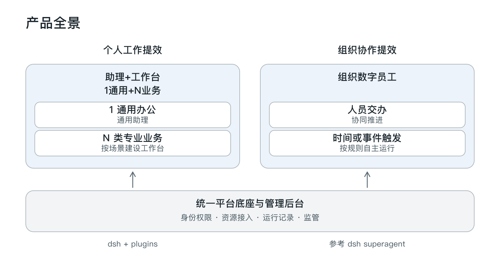
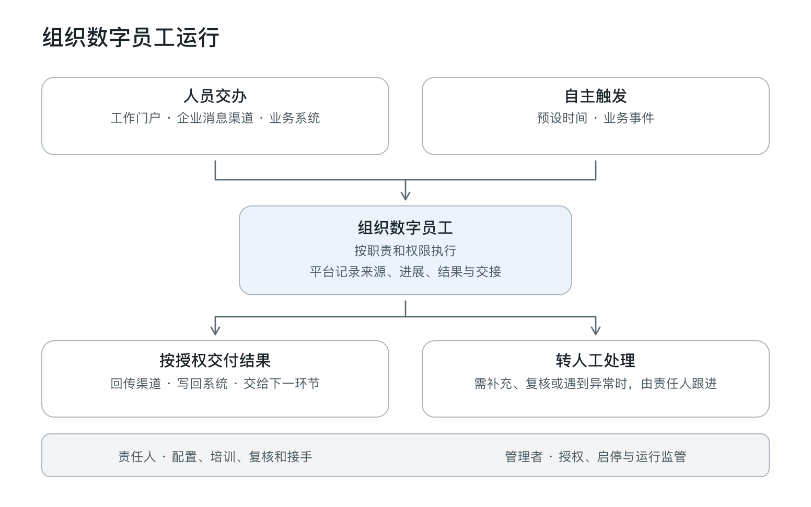
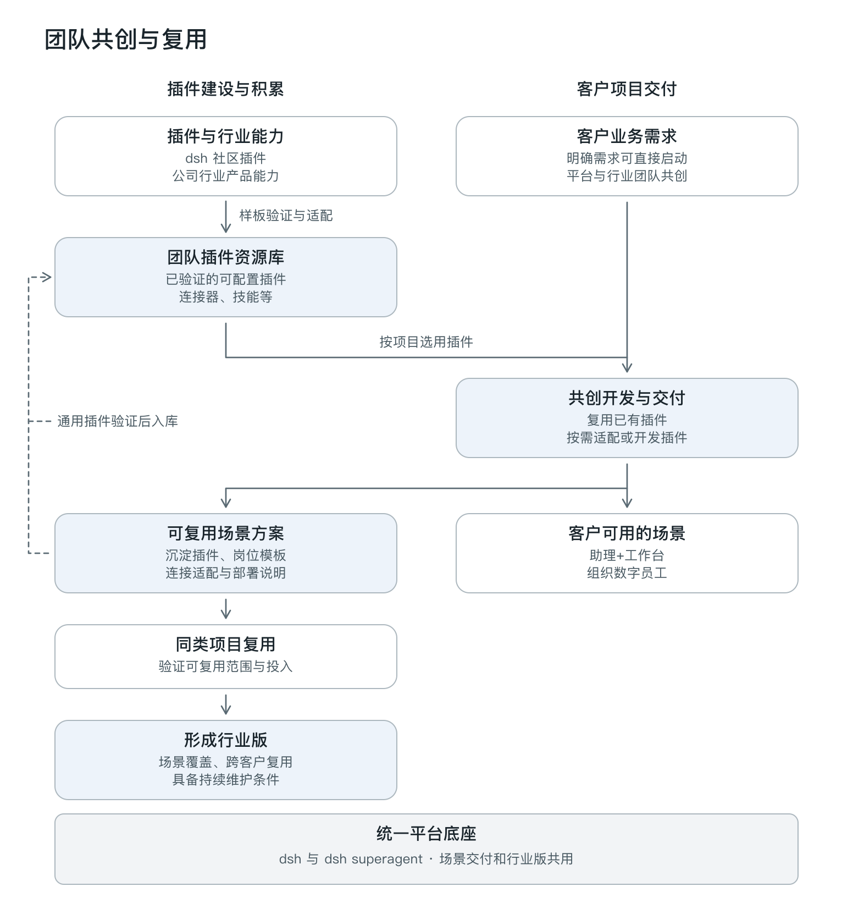

# Enterprise AI

## 1. 面向的客户、用户和场景

我们面向企业，关注两类业务机会。第一类是**提升个人工作效率**，让员工更高效地完成通用办公和岗位工作。第二类是**提升组织协作效率**，让真人、AI 员工和现有业务系统围绕同一项工作分工，把业务从触发推进到交付。

目前团队已有交互原型，暂无客户案例。下列业务场景是寻找试点时的候选方向，首批服务的行业、企业和岗位待实际接触后确定。

### 1.1 面向的客户和用户

企业是采购和部署方，业务部门是发现需求、开展试点和验证成效的主要合作方。一项业务能否落地，通常涉及四类人。

| 角色 | 关注的问题 |
| --- | --- |
| **一线员工与专业岗位人员** | 哪些操作最耗时，工作能否更快完成，交付结果是否方便检查和修改。 |
| **业务负责人** | 哪段工作最值得改善，如何分工和交接，结果要达到什么标准，遇到异常由谁处理。 |
| **IT、数据和业务系统负责人** | 如何接入现有系统，哪些数据和操作可以授权，上线后由谁维护。 |
| **投入决策者** | 改善能否持续，实施和维护需要多少投入，方案能否扩展到其他部门或同类业务。 |

前期接触企业时，优先寻找**有明确业务负责人、工作反复发生、能拿到授权样本、结果可以核验**的场景。先了解企业实际怎么做，再判断适合从通用办公、专业岗位还是一段业务流程切入。

### 1.2 场景一 · 提升个人工作效率

这一类场景从**员工手上的一项工作**出发。**助理+工作台（1通用+N业务）**覆盖通用办公和专业业务。员工可以用通用助理处理日常办公，也可以在专业工作台操作图纸、订单、台账等业务对象，由助理结合当前资料和所选对象辅助处理。员工判断结果并完成交付。

| 场景 | 典型工作 |
| --- | --- |
| **日常办公** | 汇总多份材料、整理会议行动项、撰写通知或报告初稿。 |
| **工程设计** | 查看图纸、比较两个版本、定位变化并整理变更说明。 |
| **工程造价** | 汇总项目台账，检查签证材料是否齐全，核对工程量、单价和金额。 |
| **招投标准备** | 从公告中提取资质、交付和截止时间要求，对照企业材料并标记待核实项。 |
| **外贸跟单** | 从邮件和附件中整理货品、数量、交期及交付要求，检查单证字段和缺失信息。 |

衡量个人提效时，对比员工完成同等质量工作的实际用时，把检查、修改和返工时间一并计入。例如，投标专员借助助理核对公告时，可以比较**每份公告的人工处理时间和核对质量**。

### 1.3 场景二 · 提升组织协作效率

这一类场景从**一项需要持续运行或由多个岗位共同完成的业务**出发。企业为 AI 员工定义职责，授予它使用知识库、技能、MCP、浏览器控制等资源和工具的权限。人员可以在日常使用的渠道交办和跟进，例行工作也可以由时间或业务事件触发。AI 员工可以承担一个流程节点，也可以在职责范围内自主完成一段短流程，把结果和依据交给真人、其他 AI 员工或原业务系统。业务负责人明确职责范围、交付要求和人工接手安排，管理者落实正式运行授权。

**「智能组织」描述的是一种工作方式。** 企业围绕业务结果安排真人、AI 员工和现有系统的分工。设计流程时，需要说清楚工作何时开始、上一步交付什么、下一步收到什么，以及最终由谁确认结果。

| 候选场景 | 分工与交接方式 |
| --- | --- |
| **设计变更与下游确认** | 新版图纸发布后，AI 员工整理变更项，附上版本和图纸位置，把待确认事项分别交给工艺和采购。工艺确认工序影响，采购确认备料影响，业务负责人跟进未解决事项。 |
| **客户订单核对与开票** | 收到客户订单后，AI 员工对照合同、价目或促销规则，识别价格和数量差异。订单人员核实差异，需要客户确认时由销售跟进，确认后的订单进入开票流程。 |
| **供应商发票异常处理** | 发票与采购单匹配失败时，AI 员工按已确认的规则校正编号并重新匹配。通过校验的单据回到财务流程，金额差异或仍无法匹配的单据由财务人员处理。 |
| **外贸订单与出运准备** | 单证 AI 员工从订单及附件中提取货品、数量和交期，装运 AI 员工据此生成装柜方案和待确认项。跟单人员补齐信息，物流人员确认实际出运安排。 |
| **招投标机会筛选与立项** | AI 员工按日筛查公告并整理候选机会，附上筛选依据，将技术条件和商务要求交给对应人员核实。投标负责人结合反馈决定是否立项。 |
| **销售线索分配与跟进** | 收到线上咨询或活动线索后，AI 员工补充地区、产品意向等信息，按企业规则将线索分配给销售。销售接手沟通，并将跟进结果录入客户管理系统。 |
| **设备报修与维修派工** | 设备故障上报后，AI 员工整理告警、设备档案和历史维修记录，向维修人员提交故障线索。维修人员确认原因并处置，实际结果用于完善后续排查资料。 |
| **内部服务与知识沉淀** | 员工可以在企业消息渠道提出 IT、行政或人事办理请求，AI 员工按规则答复或将工单交给对应职能人员。它也可以在新工单进入待分派状态时自动补齐信息并分派。办理完成后，有复用价值的答复经审核进入知识库。 |

#### 公开案例参考

- **达能的订单核对。** AI 在开票前比对订单与内部系统的价格，标出差异并给出建议，由业务人员与客户核实处理。[微软客户案例](https://www.microsoft.com/en/customers/story/25506-danone-microsoft-365-copilot)
- **Asurion 的发票异常处理。** AI 在既有财务流程中修正规定范围内的编号问题，数据重新校验后进入财务系统。[微软客户案例](https://www.microsoft.com/en/customers/story/27456-asurion-insurance-services-microsoft-copilot-studio)
- **C.H. Robinson 的货运接单。** 一个智能体补齐托运请求中的货物分类和编码，另一个智能体利用这些字段把邮件托运请求转为系统订单。[C.H. Robinson 官方案例](https://www.chrobinson.com/en-us/about-us/newsroom/press-releases/2025/chrobinson-launches-an-ai-agent-to-help-shippers-adapt/)

组织提效看**从业务触发到交付的整体结果**，包括处理周期、交接等待、遗漏和返工，以及人工复核与异常处理的实际负担。以招投标为例，专员更快核对一份公告体现个人提效。团队更早发现机会、让技术和商务及时完成核实并在截止前作出立项决定，体现组织协作提效。

## 2. 产品与交付形态

平台规划两种产品形态。**助理+工作台（1通用+N业务）**帮助员工完成通用办公和专业工作，计划复用 DeepSeek Harness（dsh）及其插件。**组织 AI 员工**承担企业分配的岗位职责，任务执行参考 dsh superagent，可以通过企业已有的工作入口提供服务，也可以在后台按规则自主运行。两种形态可以分别交付，也可以围绕同一项业务组合使用。企业通过统一的**管理后台**管理组织资源、助理、业务工作台和组织 AI 员工。

目前的交互原型可演示助理分配与共享、工作台操作、组织 AI 员工交办和模拟事件。团队已对 dsh 和 dsh superagent 的参考实现做了静态核查。真实模型与执行服务、生产权限、企业消息渠道、业务系统接入和定时调度仍待实施。[项目实现状态与实施待定项](../dsh_platfrom_prd.md#九实现状态与实施待定项)

### 2.1 助理+工作台（1通用+N业务） · dsh + plugins

**1通用**指通用办公，员工可以独立使用通用助理整理资料、分析信息和生成产物。**N业务**指由专业工作台承载的多个业务场景。办理专业业务时，员工在工作台查看和操作图纸、订单或台账，助理根据当前对象及所选范围调用专业工具。员工在同一界面检查依据、调整结果，并按业务权限确认或写回。

| 能力 | 拟采用的实现路径 |
| --- | --- |
| **通用助理** | 复用 dsh 的模型接入、会话、工具调用和技能加载。平台把会话和产物关联到员工账号及其工作空间，并校验可使用的资源。 |
| **专业助理** | 用 dsh 的预设（preset）组合岗位指令、技能和工具，通过插件或 MCP 接入企业知识库及业务系统。企业检查规则、报告模板和工作示例随场景配置。 |
| **业务工作台** | 通过插件提供或接入专业业务操作和数据服务。工作台把当前业务对象、选区及可执行操作传给助理，再接收分析结果或待确认操作。现有 Vue 原型可先评估通过平台后端调用 dsh API 或 SDK。适合在 dsh Web 内交付的场景，可评估开发其浏览器模块。 |

| 多人协作方式 | 使用方式 |
| --- | --- |
| **共享助理或配置资源** | 成员可以共享助理的配置使用权，也可以单独共享获授权的技能、知识、MCP 和插件等配置资源。直接使用共享助理时，成员在各自的个人工作空间发起会话、处理资料和保存产物。会话、文件、产物和凭据各自校验权限。 |
| **创建共享工作空间** | 多人共同办理一项业务时，可在共享空间使用各自获授权的助理。助理按成员权限读取当前空间的资料，成员可保存结果或关联同一业务记录，供同事接续。共享空间、产物接续及空间内会话的可见范围待设计验证。 |

以招投标的场景设计为例，投标专员可以共用筛选助理和资质核对技能，各自在个人空间复核负责的公告。某项机会需要技术、商务共同评估时，成员可在共享空间选用各自适合的助理，将确认后的结论交回同一机会记录。方案中由 dsh 运行会话、技能和工具，平台校验成员能使用的资源、能读取的资料以及结果的保存位置。[dsh 架构](https://github.com/deepseek-ai/deepseek-harness/blob/master/docs/architecture.md) · [招投标工作台原型与接入状态](../dsh_platfrom_prd.md#九实现状态与实施待定项)

### 2.2 组织 AI 员工 · dsh superagent

企业为 AI 员工配置岗位职责、可使用的知识与工具、业务权限、结果接收人和异常接手人。按任务发起方式，组织 AI 员工有两种工作方式。

| 工作方式 | 如何发起和推进 | 结果如何交付 |
| --- | --- | --- |
| **人员发起、协同推进** | 获授权的人员可以在工作门户或企业消息渠道联系 AI 员工、交办、补充信息和跟进进度，也可以在已有业务系统中操作，由该系统调用平台服务。钉钉、飞书和企业微信是候选接入渠道。 | 结果按授权返回发起渠道，或写回原业务单据和任务。需要补充信息或人工确认时，通知相应人员继续处理。 |
| **时间或事件触发、自主运行** | 到达预设时间，或发生新单据待处理、工单状态变化等业务事件时，AI 员工按规则启动任务，在授权范围内完成一段工作或推进流程节点。 | 按规则写回业务系统、通知指定人员，或将结果交给下一个流程节点。需要复核、补充信息或出现异常时，由指定责任人跟进。 |

使用入口和任务触发方式可以组合。以飞书接入后的招投标场景为例，专员可以发消息请 AI 员工核查公告，AI 员工也可以每天自动筛查新公告，再把候选清单发到飞书。平台统一登记两种任务，关联发起人或触发规则、相关业务对象、运行状态、结果和交接记录。

每个组织 AI 员工有**使用者、责任人、管理者**三类角色。同一人可以兼任，也可以在不同 AI 员工上承担不同角色。

| 职责 | 可以做什么 |
| --- | --- |
| **使用者** | 通过获授权的入口交办、补充信息并跟进本人任务。在工作门户查看自主任务的进展和结果时，同时校验 AI 员工使用权和该任务的业务访问权。 |
| **责任人** | 按配置授权维护职责、知识、技能、触发规则和交付要求，在工作门户试用和培训。按负责范围查看运行与日志，按业务授权复核结果和接手异常。配置和业务处置可由不同责任人承担。 |
| **管理者** | 分配使用权和责任人权限，管理渠道与系统接入及正式运行授权，负责启停和选择生效版本，按管理范围查看运行、异常和获授权日志。 |

试用培训与正式运行各自记录。获发布授权的人员在工作门户发布稳定版本，管理者在后台决定何时生效。单次沟通中的补充或纠正可以先用于当前任务，经责任人确认后再考虑纳入配置或工作样本。

平台在受理请求时校验人员或业务系统的调用权限，AI 员工按获授权的组织身份执行，平台再校验该身份可使用的连接和可读写的业务对象。运行监管、任务操作和业务结果查阅分别授权。外部入口的身份映射和结果访问规则随接入场景明确。

任务执行优先参考 dsh superagent 的研究原型。该原型面向单个 GitHub 仓库的编码任务，展示了任务受理、独立会话和工作目录、等待补充和结果回传。组织身份、企业业务系统、消息渠道和正式触发规则由平台适配。[dsh superagent 参考原型](https://github.com/deepseek-ai/dsh-superagent-prototype) · [项目技术核查](../dsh_platfrom_prd.md#八技术方向与静态核查)

### 2.3 管理后台

管理后台面向获授权的管理者，负责组织范围内的能力分配、渠道和系统接入、生效版本、启停和运行监管。工作门户是组织 AI 员工的使用入口之一，也供责任人配置、试用和培训 AI 员工，查看运行日志并处理具体任务和异常。

| 管理对象 | 后台功能 |
| --- | --- |
| **组织资源** | 管理模型、知识、技能、MCP、插件和工具，查看维护人、可用状态、授权范围及依赖关系。系统接入负责维护实际连接、凭据和连通状态。 |
| **助理** | 管理组织提供的助理，查看配置版本和所用资源，分配使用权、启停和调整生效版本。员工可以在工作门户配置和共享自己的助理。 |
| **业务工作台** | 管理已交付的工作台、使用范围、启停、生效版本、配套助理和依赖连接。工作台与配套助理可一并分配，各项授权可单独收回。工作台里的订单、图纸、公告等仍按业务权限访问。 |
| **组织 AI 员工** | 指定责任人、分配使用权，管理已接入的渠道，调整正式运行的授权上限、启停及生效版本，查看管理范围内的任务来源、运行状态、异常和获授权日志。 |

管理者可以从成员详情查看获授能力，从资源或连接详情查看受影响的助理、工作台和组织 AI 员工。人员交办与自主任务都纳入监管。运行记录用于追查任务来源、执行版本和异常，管理变更记录用于追查授权、启停和版本调整。对话正文、业务数据及产物按相应权限查阅。在途任务的处理方式按业务场景设计。

例如，招标查询连接失效时，管理者在后台查看受影响的工作台和筛选 AI 员工，恢复连接后，责任人在工作门户核对失败任务并处理异常。dsh 和 superagent 提供执行机制，平台负责把资源、成员授权、执行身份和任务记录关联起来。

### 2.4 平台底座与客户交付

团队按客户的工作流程交付**场景方案**，从助理+工作台（1通用+N业务）和组织 AI 员工两种产品形态中选配所需能力，明确使用入口或触发方式、结果去向、异常接手人和后续维护分工。

客户已有业务系统时，可沿用原有的业务入口和单据。业务系统调用 AI 员工服务，并接收状态或结果。平台记录任务执行和交接情况，由双方按场景约定结果写回的位置与查阅权限。后台自动化场景由时间或事件触发，责任人在平台跟进运行与异常。

| 交付内容 | 如何建设与复用 |
| --- | --- |
| **平台公共能力** | 提供身份与权限、渠道和系统接入、助理与任务运行、人工接手及运行监管。平台记录 AI 员工的任务状态，业务单据与结果按约定保存和交接。 |
| **可复用场景能力** | 将工作台模块、技能、连接器和岗位预设整理成可复用组件。可评估用 dsh 的 bundle 分发插件和配置，用 profile 组织启动组合与环境配置。 |
| **客户环境配置** | 绑定客户知识、业务规则、系统连接、凭据及责任人。结合私有云、企业内网或边缘环境要求，明确推理、执行、业务数据和日志各自的位置，以及消息渠道可接收的信息范围。 |

接入生产环境前，团队与客户确认调用身份、业务对象的读写范围、数据与凭据隔离，以及重复触发、写回失败和人工接手的处理方式。涉及客户数据的开发可先在隔离环境使用授权样本。

## 3. 团队的工作方式

### 3.1 建设统一底座，与公司其他产品团队共建场景

**平台团队负责通用底座。** 以 dsh 和 dsh superagent 为技术基础，为两种产品形态提供扩展和运行能力，以及资源接入、权限、任务记录和部署等公共能力。项目中反复出现的共性需求纳入平台研发，专门的业务规则和专业操作由场景模块承接。

**公司其他产品团队提供行业和场景能力。** 合作团队可提供已有产品、专业功能、业务对象、规则及接口。项目启动时，平台团队与合作团队共同选定业务环节，明确牵头人、接入范围及上线后的维护分工。具体合作团队和人员投入待确认。

合作可以从已有产品的一段业务流程切入。需要沿用客户的工作入口时，行业产品团队维护业务界面与流程，平台团队提供助理或 AI 员工的接入与运行能力。需要在平台上组合多项专业能力时，行业产品通过插件或接口提供能力，由业务工作台或组织 AI 员工调用。例如，行业团队维护专业算量功能，平台团队把它接入图纸复核场景，将计算结果交给业务人员确认。

### 3.2 运营插件生态和资源库，用内部样板验证场景

围绕拟进入的行业和场景，定期跟踪 dsh 社区插件和版本更新，同时盘点团队已有资源及公司内部可接入的产品能力。选取有代表性的任务做内部样板，跑通业务输入、工具调用、结果输出和人工复核，判断哪些能力可以复用、需要适配或需要新开发。样板也可以用于和客户讨论业务入口、系统对接和结果确认方式。

插件、连接器、技能和模板在纳入团队资源库前，核对来源与许可、版本兼容性、所需权限和部署条件，结合样板完成必要改造。入库资源记录适用场景、版本和维护人，供后续项目配置使用。上游更新或客户环境变更时，维护人确认资源是否需要适配或替换。

### 3.3 与客户共创并交付场景

团队采用类似 FDE 的现场共创与交付方式。可以带着内部样板和客户讨论，也可以从明确的项目需求直接起步。交付人员与客户业务和 IT 负责人梳理任务、数据来源、例外情况与接手分工，优先复用团队资源库和已有产品能力，再按现场需求适配或开发插件、连接和配置。

每个项目争取形成两项成果。

- **客户可以使用的业务场景。** 按需交付助理+工作台（1通用+N业务）、组织 AI 员工，或两者的组合。上线后由各方按维护分工跟进任务结果、异常和变更。
- **可带到下一个项目的场景方案。** 整理可复用的模块、插件、助理或 AI 员工模板、连接适配和部署说明。客户专属规则、数据和凭据随项目管理。

### 3.4 从可复用场景发展为行业版

先按业务需要将插件、助理、工作台和组织 AI 员工组合成可部署的场景方案。在同类项目中记录哪些能力可直接沿用、哪些需要适配，以及部署和后续维护的投入。当同一行业积累出一组能够衔接的场景，可以将行业产品接入、专业规则、工作台和 AI 员工岗位整合为行业能力包。

**各行业版共用同一个智能平台底座。** 插件数量用于观察能力覆盖度。推出行业版的时机取决于相关场景能否覆盖一组实际业务、能否在不同客户中复用并减少实施投入，以及团队能否持续维护。满足这些条件后，行业能力包可以进一步发展为独立对外交付的行业版。

## 附录 A. 竞品调研与产品对照

| 对标产品 | 已公开的能力 | 对我们的参考 |
| --- | --- | --- |
| **飞书 · 专属工作伙伴、企业工作伙伴、妙搭** | 分别面向个人和团队。企业工作伙伴可配置岗位能力和应用身份，aily 工作流可接入妙搭应用。 | 对照个人与组织角色的划分，以及业务应用内嵌助理的方式。[飞书选型说明](https://aily.feishu.cn/hc/1u7kleqg_7xmbj121) · [妙搭集成](https://aily.feishu.cn/hc/8dlnbe0s_0p1wh745) |
| **钉钉 · 悟空** | 提供通用 AI 入口、技能及定时任务，并推出覆盖岗位分析、匹配和报告的猎头工作台。 | 对照通用助理怎样组合专业技能并交付岗位产物。[悟空产品文档](https://wukong.dingtalk.com/docs/about/) · [更新日志](https://wukong.dingtalk.com/docs/changelog/) |
| **Autodesk · AutoCAD＋Autodesk Assistant** | AutoCAD 2027.1 支持助理感知当前选区，在设计过程中查询和统计图纸数据。 | 对照专业工作台怎样把当前图纸与所选范围交给助理。[AutoCAD 发布说明](https://www.autodesk.com/blogs/autocad/autocad-2027-1/) |
| **微软 · Dynamics 365 Business Central** | 销售订单智能体监听指定邮箱，形成报价或订单，人员可在任务时间线上复核、补充或停止处理。 | 对照自主执行、人工接手和处理完毕后继续办理的体验。[销售订单智能体文档](https://learn.microsoft.com/en-us/dynamics365/business-central/sales-order-agent-process) |
| **用友 · BIP 6、YonWork、FDE** | 以平台底座支撑统一工作入口和领域智能体，已披露客户共创与企业内网运行的软硬件方案。 | 国内整体形态的直接对照，关注场景适配和部署维护的实际投入。[BIP 6 产品介绍](https://www.yonyou.com/subject/yonbip/news/6468) · [FDE 与部署方案](https://www.yonyou.com/news/6319) |
| **Palantir · Foundry、AIP、Apollo** | 可围绕业务对象搭建工作台，在应用内查看和介入智能体会话，支持事件触发与多环境部署管理。 | 对照业务对象、操作界面、智能体执行和现场交付如何衔接。[AIP 智能体运行](https://www.palantir.com/docs/foundry/aip/agent-stack) · [Apollo 部署管理](https://www.palantir.com/docs/apollo/core/introduction/index.html) |

OpenAI Frontier 和 FDE 可补充参考智能体运行治理及现场共创。Dify Enterprise 提供企业自行搭建工作流和私有部署的选项。我们的差异化仍需用目标场景的实际结果验证，重点看能否接入客户已有系统、完成可复核的业务交接，以及下一次交付能否减少适配投入。[OpenAI Frontier](https://openai.com/business/frontier/) · [OpenAI FDE](https://openai.com/business/forward-deployed-engineering/) · [Dify Enterprise](https://dify.ai/dify-enterprise)

### 共享与角色权限对照

- **共享空间与会话。** Claude Projects 共用项目知识和指令，会话默认私有，可主动共享。ChatGPT 共享项目让成员访问项目内会话、文件和指令，并使用项目内上下文。两种方式分别适合复用同一套能力和接力处理同一件事。微软 Loop 的群组归属空间由群组决定权限和生命周期，可参考其共同产物的归属方式。[Claude Projects](https://support.claude.com/en/articles/9519189-manage-project-visibility-and-sharing) · [ChatGPT 共享项目](https://help.openai.com/en/articles/10169521-projects-in-chatgpt) · [微软 Loop](https://learn.microsoft.com/en-us/microsoft-365/loop/loop-storage?view=o365-worldwide)
- **共享助理与资源。** Microsoft 365 Agent Builder 分别处理助理与 SharePoint 文件授权。助理回答时遵循使用者的信息访问权限，收回助理使用权后，已授予的文件权限仍由 SharePoint 管理。[微软助理共享说明](https://learn.microsoft.com/en-us/microsoft-365/copilot/extensibility/agent-builder-share-manage-agents?view=o365-worldwide)
- **使用、配置与执行身份。** Dynamics 365 的销售订单智能体区分处理任务与配置实例的权限。Copilot Studio 区分使用、测试与编辑，微软的组织目录上架另有管理员审批。飞书企业工作伙伴支持技能使用应用身份或用户身份执行。可分别参考任务授权、发布管理和运行身份。[微软销售订单智能体](https://learn.microsoft.com/en-us/dynamics365/business-central/sales-order-agent-setup) · [Copilot Studio 共享](https://learn.microsoft.com/en-us/microsoft-copilot-studio/agents-experience/authoring-share-agent) · [微软组织目录审批](https://learn.microsoft.com/en-us/microsoft-agent-365/admin/agent-requests?view=o365-worldwide) · [飞书执行身份](https://aily.feishu.cn/hc/1u7kleqg_kzf5gv50?_lang=zh)

### 管理后台对照

- **飞书。** aily 企业应用管理覆盖所有者和协作者、可用范围与应用启停。MCP 可独立上下架，低代码管理后台支持企业级发布审核。[企业应用管理](https://aily.feishu.cn/hc/1u7kleqg_q4vdkyr1) · [MCP 服务管理](https://aily.feishu.cn/hc/1u7kleqg_yukaniuj) · [低代码管理后台](https://www.feishu.cn/content/673236929689)
- **微软。** Power Platform 后台统一盘点应用、流程和智能体，并可查看各自依赖的连接器。Agent 365 后台提供使用概览、异常、待审批和负责人缺失等信息。[Power Platform 资产清单](https://learn.microsoft.com/en-us/power-platform/admin/power-platform-inventory) · [Agent 365 管理概览](https://learn.microsoft.com/en-us/microsoft-agent-365/admin/agent-365-overview?view=o365-worldwide)
- **ServiceNow。** AI Control Tower 管理企业 AI 资产及其生命周期，AI Agent Studio 支持配置、测试和按版本查看执行日志。[AI 治理生命周期](https://www.servicenow.com/docs/r/governance-risk-compliance/ai-risk-management/ai-gov-lifecycle.html) · [AI Agent Studio](https://www.servicenow.com/docs/r/intelligent-experiences/ai-agent-studio.html)
