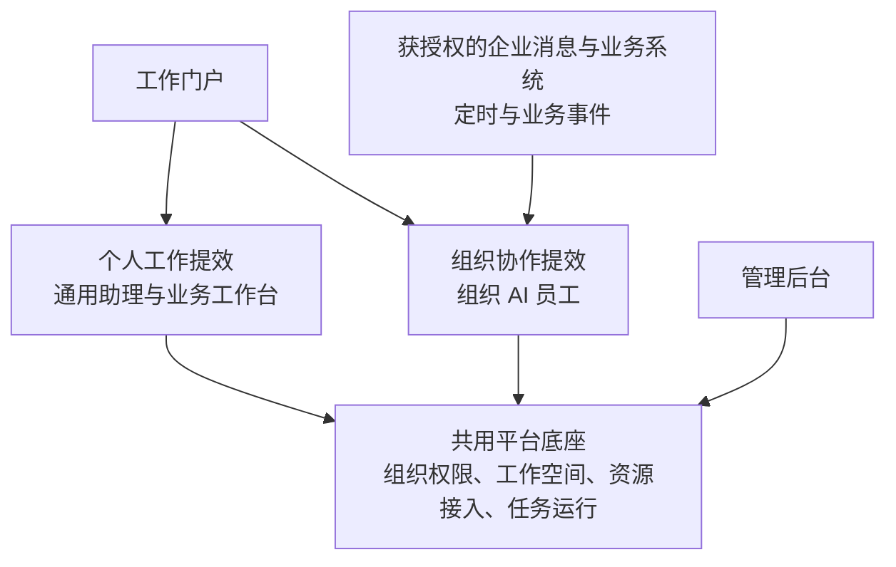

# AI 员工与助理平台项目目标

更新于 2026-11-24 · 讨论稿

本文记录平台的产品框架、目标用户、业务场景和阶段目标。功能规则、实现方案和验证状态见 [产品需求文档](dsh_platfrom_prd.md)。

## 产品定位

建设面向企业组织及组织内个人的 AI 员工与助理平台，部署在客户的私有云、企业内网或边缘环境。一方面帮助成员完成办公和专业业务，另一方面让组织能将有明确职责的工作交给 AI 员工，并跟进结果。

## 产品框架

| 组成 | 产品职责 |
| --- | --- |
| 助理与工作台 | 以「1 通用 + N 业务」覆盖个人工作。通用助理支持日常办公，专业工作台承载特定业务的资料和操作，助理围绕当前业务对象提供辅助。 |
| 组织 AI 员工 | 以职责为单位配置和发布。AI 员工通过工作门户、获授权的企业消息渠道或既有业务系统受理交办，也可由时间或业务事件触发，完成职责范围内的短流程或承担其中的节点。 |
| 共用平台底座 | 提供组织身份与权限、个人及共享工作空间、AI 员工工作空间和任务运行能力。助理和 AI 员工按授权使用模型、技能、MCP、知识和工具等资源。 |
| 管理后台 | 管理组织成员、能力分配以及组织资源、助理、业务工作台和 AI 员工，跟进平台运行和组织能力的使用。 |

## 服务对象

| 对象 | 主要诉求 |
| --- | --- |
| 企业组织与业务部门 | 选择需要改善的业务场景，采购、部署平台，评估效率、质量和交付成效。 |
| 组织内成员 | 使用自行配置、组织分配或其他成员共享的助理，通过获授权的工作台办理业务，也可向可联系的 AI 员工交办任务和跟进结果。 |
| AI 员工负责人 | 配置职责与工作规则，试用和发布 AI 员工，跟进运行，处理需要人工介入的事项。 |
| 组织管理者 | 管理组织能力与资源的使用范围、分配和启停，查看整体运行情况。 |

同一成员可以按授权承担多种角色。企业的客户和合作伙伴可作为业务服务对象，是否向他们开放平台账号或入口待确认。

## 目标场景

| 场景 | 使用方式 | 期望结果 |
| --- | --- | --- |
| 通用办公 | 成员与助理沟通，围绕个人资料整理信息、分析数据或起草文档。 | 获得可继续编辑和复用的办公产物。 |
| 专业业务 | 成员在获授权的业务工作台处理图纸、台账等业务对象，使用助理完成分析或检查。多人办理同一事项时，可按授权访问共享资料。 | 产出可核对、可交付的业务结果。 |
| 组织任务 | 成员交办，或由时间、业务事件触发 AI 员工执行。需要判断或验收时，可交给有权限的人员处理，也可将结果传给后续 AI 员工或业务系统。 | 任务进展、异常和结果可跟进，工作可交接、复核。 |

ET-052 原型模拟了图纸检查流程。设计人员在工作台使用助理查看图纸、整理检查清单。新版图纸发布后触发 AI 员工检查，经过人工复核的结果写回共享空间。

ET 设计、工程造价、招投标、外贸、项目管理和界面设计已有工作台原型。专业咨询、经营分析、内外部服务和岗位培训可进一步探索。平台通用项目协作暂缓，项目管理作为独立业务工作台验证。首批交付场景待确认。

## 总体目标

| 目标 | 验证依据 |
| --- | --- |
| 提升个人工作效率和产出质量 | 比较典型任务的完成耗时和结果质量，观察成员是否持续使用。 |
| 让组织可交办、监管并验收 AI 员工完成的工作 | 记录任务结果、人工介入和异常恢复情况，验证任务能否在授权范围内执行。 |
| 让企业在自身环境管理和分配 AI 能力 | 在试点验证部署、权限分配、资源使用和运行监管。 |
| 提升场景交付效率，逐步形成行业版或场景版 | 记录客户适配周期、交付质量、维护投入和跨项目复用情况。 |

## 团队转型与现阶段验证

「平台底座＋进入企业实际场景开发」是团队希望验证的转型方向。目前暂无客户案例，现有原型用于演示和场景讨论。客户需求、真实部署与使用成效、交付投入和跨项目复用仍待验证。

平台团队负责共用底座，拟与公司其他产品团队共建场景，由合作团队提供专业产品和行业能力。团队持续跟踪 dsh 插件生态，在内部样板中验证来自生态、团队资源库和公司产品的能力，并将经过验证的复用成果纳入团队资源库。

项目交付拟采用类似 FDE 的方式，与客户业务和 IT 负责人共同梳理任务、开发并交付场景，从中沉淀可复用的能力、岗位方案和业务模块。行业版和场景版共用平台底座，推出时机以场景覆盖、跨客户复用和持续维护条件为依据。[团队的工作方式](EnterpriseAI/EnterpriseAI.md#3-团队的工作方式)

## 后续待讨论

- **优先用户**。首个试点面向哪类组织、部门或岗位，由谁提出需求、使用和验收？
- **首批场景**。从哪项工作切入，覆盖到哪个业务结果，哪些环节需要人工确认？
- **平台与交付边界**。首版需要哪些共用能力，哪些工作台、岗位和流程随客户交付验证？
- **试点成效**。用哪些指标和目标值验收，由哪些团队参与、投入多少人员？

## 重要变更记录

- **2026-11-03** 确立同时建设平台产品与客户交付底座的目标，并逐步沉淀行业版、场景版。
- **2026-11-05** 暂缓面向终端用户的项目化协作功能。
- **2026-11-06** 确认行业或场景差异应体现在实际业务工作中。
- **2026-11-10** 进一步明确企业组织及组织内个人是主要服务对象。个人助理、AI 员工及场景应用构成重新讨论产品架构的出发点。
- **2026-11-11** 增加独立的项目管理工作台候选原型，验证项目任务、排期与复盘。
- **2026-11-11** 将功能架构、产品规则、技术实现和验证状态迁入 PRD，本文聚焦产品定位与总体目标。
- **2026-11-11** 确认组织可管理助理并向个人分配，个人可使用组织或其他成员共享的助理。
- **2026-11-14** 确认个人工作提效与组织协作提效两类场景及其对应产品功能。团队拟转向平台底座与企业场景交付并行的方式，目前暂无客户案例。
- **2026-11-14** 明确组织 AI 员工可从企业消息渠道和既有业务系统使用，也可按时间或事件自主运行，由平台统一记录和监管。首批接入范围随试点确定。
- **2026-11-16** 将原「数字员工」统一命名为「AI 员工」。
- **2026-11-24** 重整项目目标文档，增加产品框架图和待讨论事项。
